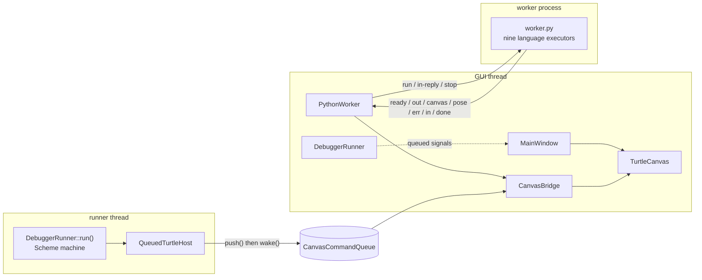

# Architecture Guide

## Time Warp Studio v16.0.0 — System Design and Implementation

> **This page describes the shipping product.** It was rewritten alongside the move
> to C++20 / Qt6. Earlier revisions documented the PySide6 implementation, which has
> been removed, and named modules (`ui/*.py`, `themes.py`, the Python threading
> model) that no longer exist. Nothing here describes code that is not in the tree.
> Where the interface carries a control whose feature is not built yet, this page
> says so; [ROADMAP.md](ROADMAP.md) tracks the work.

---

## Table of Contents

1. [Overview](#overview)
2. [Process and thread model](#process-and-thread-model)
3. [The canvas command queue](#the-canvas-command-queue)
4. [The Qt application](#the-qt-application)
5. [The native engines](#the-native-engines)
6. [The language bridge](#the-language-bridge)
7. [Extension points](#extension-points)
8. [Tests and gates](#tests-and-gates)
9. [Configuration and persistence](#configuration-and-persistence)
10. [What is not here yet](#what-is-not-here-yet)

---

## Overview

Time Warp Studio is a desktop IDE for ten educational languages — **BASIC, APL,
Logo, PILOT, FOCAL, Scheme, CHIP-8, COMAL, REXX and Smalltalk** — with an integrated
turtle graphics canvas. It is a C++20 / Qt6 application, and all ten languages
run in C++ inside it. The Python engine ships as the **reference** the parity
gates, the command matrix and the lesson check use; no program is sent to it.

So the product is **one GUI process**. The child process remains only for a
lesson check, where a second interpreter must not share the document's state;
that channel is JSON lines, one message per line — program text going in and a
stream of JSON messages coming back.

### The moving parts

| Part | Sources | Runs in | Role |
| --- | --- | --- | --- |
| `timewarp_ui` — the IDE | `native/src/ui/`, `native/include/timewarp/ui/` | GUI thread | Documents, editor, console, canvas, menus, settings |
| `timewarp_canvas` | `native/src/canvas/` | producer: interpreter thread; consumer: GUI thread | Carries drawing across the thread boundary |
| `timewarp_canvas_qt` | `native/src/canvas/qt_bridge.cpp` | GUI thread | Qt glue for that queue: wakeup and draining |
| `timewarp_scheme` | `native/src/scheme/` | runner thread, in-process | Scheme, on an explicit-stack machine with no native recursion |
| `timewarp_lang` | `native/src/lang/` | runner thread, in-process | The shared interpreter loop and every line-by-line executor: BASIC, FOCAL, PILOT, COMAL, APL and REXX, plus whole-program CHIP-8, Logo and Smalltalk |
| `timewarp_debugger` | `native/src/debugger/` | its own `QThread` | Runs a Scheme program and services pause / step / breakpoint requests |
| `timewarp_bridge` | `native/src/bridge/` | GUI thread, driving a `QProcess` | The IDE's end of the Python bridge |
| `timewarp_expr` | `native/src/token.cpp`, `lexer.cpp`, `evaluator.cpp` | runner thread, in-process | The ported expression evaluator, linked into `timewarp_lang` — see the note below |
| the bridge engine | `native/bridge/` | a separate Python process | The reference the parity gates, the lesson check and the command matrix compare against |

> **`timewarp_expr` is part of a Run now.** It builds, it has 485 checks of its
> own, `native/tools/differential_check.py` compares it against the Python
> reference on a fixed corpus, and `timewarp_lang` links it: BASIC, FOCAL,
> PILOT, COMAL, APL and Logo evaluate every arithmetic expression through it. The
> parity gate is what keeps the native evaluator honest.

### Two contracts holding the design together

**Interpreters do not touch widgets.** A language engine never sees a `QWidget`. It
turns turtle calls into `CanvasCommand` values and pushes them into a
`CanvasCommandQueue`; the GUI thread drains that queue and paints. That is what
makes a program drawing 100,000 segments cost 100,000 lock-free appends rather than
100,000 Qt signal deliveries.

**Executors are stateless command processors.** An engine turns a statement into
text and nothing else. No engine holds a reference to the canvas, the console or the
window, so the same engine is usable from a test with no GUI at all.

---

## Process and thread model

There are three places code can run, and the rules differ between them.

| Context | Owns | May touch |
| --- | --- | --- |
| **GUI thread** | Every widget, `QSettings`, the canvas display list | Anything |
| **Runner thread** — `debugger::DebuggerRunner`, a `QThread` | A running Scheme program and its machine state | The canvas queue, through a host adapter. Never a widget |
| **Worker process** — `bridge::PythonWorker` around a `QProcess` | The Python interpreter and the language state | Its own protocol on stdout; a child process cannot reach a widget anyway |



### Control going *in* deliberately does not use slots

`DebuggerRunner` subclasses `QThread`, and its `run()` **is** the interpreter loop. A
thread cannot spin an interpreter loop and a Qt event loop at the same time, so that
thread has no event loop and a queued slot invocation to the runner would never be
delivered — it would sit in a queue nobody reads.

That interacts with a classic Qt trap: a `QThread` *object* lives in the thread that
constructed it, so its slots run there rather than in `run()`. Subclassing `QThread`
and expecting `run()`'s thread to receive slot calls is the most common Qt threading
mistake.

The consequence is deliberate. `request_stop()` and the rest are **plain thread-safe
methods, not slots**: they publish an atomic command and bump a notification counter,
and they never touch interpreter state. The reverse direction is ordinary Qt and is
used freely — signals emitted from `run()` arrive queued on the GUI thread.

The park/unpark word is *incremented* rather than merely notified, because
`std::atomic::wait` re-checks the value after every notification and goes back to
sleep if it has not changed. Calling `notify_all()` on a word nobody modified
releases nobody. A counter also means the runner cannot miss a request, since the
sequence number is read *before* the command is tested.

### Latency

The runner consults its controller at the **start of every compound form**, so a
pause or a step lands within one expression of being requested rather than at an
arbitrary quantum boundary. With no controller attached the cost disappears entirely.

### Closing the window during a runaway program

`MainWindow::closeEvent` stops every engine before it does anything else. `~QThread`
joins and the bridge worker holds a child process, so a window closed mid-run would
otherwise appear to hang. The join is bounded by one form, because that is how often
the stop flag is checked.

---

## The canvas command queue

### The problem it solves

An interpreter runs on its own thread and wants to draw; Qt widgets may only be
touched from the thread that owns them. The removed Python application bridged the
two by emitting a Qt signal per turtle call — one queued-connection post, one heap
allocation and one event-loop wakeup for every `forward(...)`. A turtle program in a
tight loop emits those hundreds of thousands of times a second, so the marshalling
cost dwarfed the drawing.

The queue replaces "one signal per command" with "one buffer for all of them": the
producer appends to a preallocated ring with no allocation and no syscall, and the
consumer drains a whole batch under a single wakeup.

### How it works

- **A bounded byte ring with free-running counters.** `head` and `tail` are monotonic
  byte offsets and are never wrapped, so both "empty" and "full" are representable and
  the buffer index is just `offset & mask`. Capacity is a power of two, so the mask
  replaces a modulo.
- **Release/acquire pairing.** The producer writes a whole record and *then* publishes
  `head` with a release store; the consumer acquires `head`, so observing
  `tail < head` guarantees the entire record is readable. `tail` is published the same
  way in the other direction. Each counter has exactly one writer, which is what makes
  this lock-free without a mutex.
- **Variable-length records.** A 72-byte `CanvasCommand` header, then an optional
  point list and optional UTF-8 text, with the length in the header. No arbitrary
  limit on either.
- **Blocking without a mutex.** When the ring is full the producer parks in
  `std::atomic::wait`: no `std::mutex`, no `condition_variable`, no kernel object
  until the wait spins down. The waiter parks on a *dedicated* wakeup word that every
  notifier increments — see the thread model above for why that is not a detail.

### Policy: never drop

A full ring **blocks the producer**; it never discards a command. A dropped turtle
segment is a wrong picture that looks like a correct one, which is the failure mode
this repository treats as the worst kind. `push_for()` and `wait_for_data()` are the
bounded variants, and they poll, because C++20 has `wait` / `notify_one` /
`notify_all` but not `wait_for` / `wait_until` — those are C++23.

### Coalescing

Pushes that are `is_coalescible()` and have an **identical adjacent predecessor**
collapse into one record. It happens in a producer-private staging buffer, never by
rewriting a published slot, because a 72-byte store is not atomic. In practice a
million state pushes coalesce to a few hundred records, so the Qt bridge posts
hundreds of wakeups instead of a million.

### The Qt side

`CanvasBridge` — in `qt_bridge.cpp`, the only Qt-facing file in the canvas library —
drives the queue from the GUI event loop. Its wakeup is a **two-phase handshake, not
a latch**: `drainNow()` clears the flag, drains, and then loops while the flag was set
again. A plain latch strands commands: clearing *after* a drain lets a push landing
mid-drain see the flag still set, skip its post, and then wait for a wakeup already
consumed; clearing *before* a drain has the mirror-image problem. The two sides agree
through an atomic read-modify-write on the same word, and those are totally ordered,
so exactly one of them takes responsibility. The worst case is a redundant drain that
applies nothing.

Signals are per **batch**, never per command: the bridge drains into a plain callback
and emits one signal carrying a count.

---

## The Qt application

### The window

`time_warp_ide` → `timewarp::ui::MainWindow`. The widget tree — editor column on the
left, output and tooling on the right, function-key bar underneath — and every sizing
decision that changes how the window behaves when resized were translated from the
removed PySide6 implementation: splitter orientations and handle widths,
`childrenCollapsible(false)` where it matters, stretch factors and the initial
`setSizes()` values. Those numbers are load-bearing; they are what stops the REPL bar
being dragged to nothing and what gives the editor 60% of the width. They are
transcribed rather than re-derived, and asserted by `ui_layout_tests`.

Three deliberate departures:

- **Every widget is named.** Qt needs an `objectName` for `saveState()` /
  `restoreState()` to persist dock and toolbar geometry at all, the stylesheet scopes
  by it, and the layout tests find nodes with it.
- **Splitter positions are persisted**, which the Python window did not do: a carefully
  dragged editor/output divider survived no restart.
- **Menus delegate.** The action catalogue belongs with the feature that owns it, not
  in one 600-line method.

### Documents

A document's identity lives on its widget: the file path is a dynamic property on the
editor and the language is derived from that path. A parallel table of paths keyed by
tab index would have to be repaired on every tab close, move and reorder, and the one
time it was not would load the wrong file's text into the wrong tab.

Two rules worth knowing:

- **A failed open has two modes.** `OpenFailure::ReportToUser` shows a dialog, which is
  right for a file the user just picked. `OpenFailure::Silent` is required for files
  named on the command line: a modal dialog at startup blocks a script or a CI run
  forever, and a mistyped path is exactly when that must not happen.
- **An already-open file is raised, not loaded twice**, so the same file cannot be
  edited in two places and saved over itself.

### The editor

`CodeEditor` is a `QPlainTextEdit` with a line-number gutter, a highlighted current
line, cursor tracking and per-language syntax colouring, because those are what make a
text box feel like an editor rather than a scratchpad. There is no minimap,
find/replace, outline or formatter yet.

The colouring is `SyntaxHighlighter`, and its rules are per language rather than one
shared approximation: REXX comments are `--` and `/* ... */`, Smalltalk's comment is a
**double**-quoted string while its string is a single-quoted one, FOCAL has no comment
syntax at all, and PILOT's units are a letter and a colon at the start of a line. The
keyword tables are the engine's own command names, so the colouring cannot teach a
word the engine would reject.

Searching is split the same way. `CodeEditor` owns it — `findNext`, `matchCount`,
`replaceAll`, `replaceCurrent` — because the document is there, and `FindBar` is the
row of controls that drives those four calls. That is what lets the wrapping, the
case handling and the single-undo-step Replace All be tested against a document with
no window in the stack.

Persistence is in two halves on purpose. `saveLayout` restores the window and
`saveSession` restores the *documents*, so `--reset-layout` can put the window back
to its defaults without losing the list of files somebody was working on. The recent
list is rebuilt every time the menu opens rather than once at startup, for the same
reason the grid's tick is: a menu that remembers its own contents disagrees with
settings the moment anything else writes them.

### The turtle canvas

`TurtleCanvas` is the graphics surface, and it is a **consumer**: the interpreter never
touches it.

- **A display list, not a pixmap.** Repainting on resize, on zoom and on pan needs the
  drawing again, so the ink is kept as geometry in world coordinates. A pixmap would go
  blurry when zoomed and could not be re-projected at all.
- **The turtle state is mirrored here.** The host adapter translates turtle calls
  one-to-one and statelessly — a `Forward` command carries a distance, not the heading
  to move along or the pen colour to draw with — so something has to replay the sequence
  and hold the state. The GUI is where it belongs; the alternative would be copying the
  state into every command.
- **The coordinate conventions are the reference's, transcribed rather than chosen**,
  from `graphics/turtle_state.py`: heading 0 is **north** and increases clockwise,
  `forward` is `x += d·sin(h), y += d·cos(h)`, and `circle` is a polygon walk. A canvas
  that draws a mirrored or quarter-turned version of the same program is worse than no
  canvas at all. `turtle_canvas_tests` asserts all three.

### Languages

`native/src/ui/language.cpp` holds the table: display name, settings key and file
extensions for each of the six, plus `languageFromKey` and `languageForFile`. The enum
order matches the Python registry's, and new languages are **append-only**, because
persisted state references these by identity rather than by position.

`languageForFile` answers `Unknown` for an unrecognised extension rather than falling
back to BASIC. The Python registry does fall back; here that fallback is the *caller's*
decision, because guessing would hide the fact that the file name says nothing about
the language.

### Styling

`native/src/ui/ui_style.cpp` owns the stylesheet, as one sheet applied once to the
window. Qt copies a widget's stylesheet to its children and re-polishes all of them on
every `setStyleSheet()` call, so six calls mean six full passes over a window with
hundreds of widgets; composing the sections and setting the result once removes that,
and gives a theme manager a single string to replace. Rules are scoped by object name,
because a bare `QTabWidget { ... }` cascades to *every* descendant tab widget —
including the output sub-tabs nested inside a page of the widget being styled. Colour
roles are written with Qt's `palette(...)` function, so the sheet follows the active
palette.

**The theme system is not ported.** The removed implementation's 33 themes are the
target, to be carried as data and applied as QSS plus a palette here. Do not describe a
theme as available until it is.

---

## The native engines

### `timewarp_scheme` — Scheme with no native recursion

The reference evaluated by recursing, so its evaluation depth *was* native call stack
depth, and CPython's 1000-frame limit capped a Scheme program at roughly 200 calls. The
port replaces every recursive site with an explicit, heap-backed continuation stack: **a
tail-recursive loop of 1,000,000 calls runs with a continuation stack 4 frames deep**,
and non-tail recursion is bounded by memory rather than by the native stack.

Values are 16-byte tagged unions pointing into a region allocator, so cycles cost
nothing; symbols are interned; frames are a `std::variant` of about eighteen
continuation types. A frame is popped before its handler runs and pushed back only when
there is more work, which is what yields proper tail calls.

Scheme is the one language that runs in-process, through `DebuggerRunner` on its own
thread.

### `timewarp_expr` — the expression evaluator

Ported from `utils/expression_evaluator.py` and gated against it. A 32-byte
trivially-copyable token that borrows its text from the source, so lexing does not
allocate; a token cache keyed on the expression text with node-stable keys; and a sorted
builtin table with a switch rather than a table of `std::function`. Three phases are
exposed separately — `tokenize`, `to_rpn`, `evaluate_rpn` — so a caller can compile once
and execute many times, with `evaluate()` as the memoising convenience path.

As noted at the top, **nothing in the application links it yet.**

### Parity as the acceptance test

Both engines are compared against their Python originals on a fixed corpus by
`native/tools/differential_check.py` and `native/tools/scheme_differential_check.py`.
Both must report **0 unexpected mismatches**; the divergences that are accepted are
printed and listed, each with a reason. That is what makes "did the port stay faithful?"
a measurable question rather than a matter of opinion.

---

## The language bridge

### Why a separate process

All ten languages now have a C++ interpreter. The Python engine is kept for a
different job: it is the **reference** the parity gates compare each port against,
the curriculum checker the Lessons panel calls, and the engine the command matrix
drives. Keeping it means "did the port stay faithful?" is a question a machine
answers instead of a matter of opinion.

The IDE itself no longer runs a program there. Each port removed its path through
the bridge, and the last one (BASIC) removed the runtime case entirely. The child
process remains the answer for work the IDE should not run in its own process: a
reference implementation that is deliberately allowed to fail, and a lesson check
that must not disturb the learner's document.

### The protocol

JSON lines, one message per line.

**In** (GUI → worker):

| Message | Meaning |
| --- | --- |
| `run` | Run a program. The source travels as a JSON string, so any program text is safe |
| `in-reply` | Answer a pending input request |
| `stop` | Stop the program |

**Out** (worker → GUI):

| Message | Meaning |
| --- | --- |
| `ready` | Handshake, sent once before the first run |
| `out` | One line of program output |
| `canvas` | A batch of drawing commands |
| `pose` | Where the turtle ended up |
| `err` | A failure, for the error panel |
| `in` | The program is waiting for a line of input |
| `done` | The run ended: `ok`, an error string, and any unsupported features |

Three things the bridge is careful about:

- **A worker that dies is an error, not a hang.** A process that exits without a `done`
  message is reported as a failure, with the stderr text, rather than leaving a run that
  never finishes.
- **A message can be split across reads.** `QProcess::readyRead` says nothing about
  message boundaries, so partial lines are buffered until their newline arrives.
- **A stray `print` cannot corrupt the protocol.** The worker redirects its own stdout
  for exactly that reason; stderr is captured separately and only ever shown as
  diagnostics.

`pose` is a signal rather than a canvas command because painting the *marker* is not
something the command stream expresses: its commands say what to draw, not where the
turtle ended up.

### Finding the worker

`locateWorker()` searches in a fixed order — `TIME_WARP_PYTHON` and `TIME_WARP_WORKER`
first, then beside the executable and two levels up (the build-tree layout), then the
working directory; then the interpreter from the repository's `.venv`, then `python3`
and `python` from `PATH`. It reports **what it looked for** when it fails, because a
missing bridge has to say which half is missing. The order is explicit rather than clever
on purpose: for a cross-process launcher, "it works on my machine" means "the paths
happen to line up here".

### The engine

`native/bridge/time_warp/` is the engine the PySide6 application used, with its UI
removed. It is standard library only; `pyttsx3` (BASIC `SAY`) and `pygame` / `inputs`
(BASIC `SOUND` / `GAMEPAD`) are imported defensively and are not required.

| Directory | Contents |
| --- | --- |
| `core/` | `interpreter.py` (dispatch and program state), `language_registry.py`, `config.py`, `sandbox.py` |
| `languages/` | The ten reference executors, and `base.py`, which documents the protocol |
| `graphics/` | `turtle_state.py` |
| `features/` | Language-level modules reached *by name* from a program |
| `utils/` | `expression_evaluator.py` — the reference `timewarp_expr` is gated against — plus error hints and validators |
| `tests/` | The engine's own suite, plus `command_table.py` |

### The executor pattern

Each language is a **function**, not a class. `languages/base.py` documents the
protocol — both execution modes have the *same* signature and differ only in what
`source` holds:

```python
def execute_logo(interpreter: Interpreter, source: str, turtle: TurtleState) -> str:
    """Execute the source and return the text to display."""
```

- **Whole-program executors** receive the entire source. Scheme is the only one, and it
  is dispatched through `_WHOLE_PROGRAM_EXECUTORS` in `core/interpreter.py`.
- **Line-by-line executors** are called once per logical line/command: BASIC, PILOT,
  Logo, COMAL and REXX. Logo names the parameter `command` for that reason, and splits
  multiple commands on one line itself.

The contract:

**Must not** store UI references, update the canvas directly, or modify the window.

**May** read and write interpreter state — variables, turtle position — and return
strings as output.

Jumping between lines is done by assigning `interpreter.current_line`, a 0-based index
into `interpreter.program_lines`. After the executor returns, if `current_line` is not
`physical_line - 1` the main loop re-dispatches without incrementing, so "run line X
next" means `current_line = X`.

Errors are returned as strings prefixed with `❌` rather than raised out of the executor
for the ordinary case.

### Output conventions

Every message the engine produces carries an emoji prefix, and the IDE's presentation
depends on the distinction:

| Prefix | Meaning |
| --- | --- |
| `❌` | Error or exception |
| `✅` | Success confirmation |
| `ℹ️` | Information |
| `🎨` | Theme or UI change |
| `🚀` | Execution event |
| `🐢` | Turtle graphics action |
| `📝` | Input prompt |

---

## Extension points

### Adding a language

1. **The executor**, in `native/bridge/time_warp/languages/my_lang.py`, as a function with
   the signature above.
2. **Register it in the bridge**: import it in `languages/__init__.py`, add
   `Language.MY_LANG` in `core/interpreter.py`, and add the extension in
   `Language.from_extension()` and `core/language_registry.py`.
3. **Register it on the Qt side** in `native/src/ui/language.cpp`: display name, settings
   key, extensions. The IDE needs this to name the language and to pick it from a file
   name.
4. **Add an example** under `Examples/my_lang/` — adding the ones that draw to
   `DRAWING_EXAMPLES` in `native/tools/example_smoke.py`, or a program that draws
   nothing passes by being silent — and a row to
   `native/bridge/time_warp/tests/command_table.py` so every new command is covered by
   `native/tools/command_matrix.py`.
5. **Add a lesson** so the curriculum can teach it: two lessons in
   `native/bridge/time_warp/features/lessons.json`, then `native/tools/teach.py validate`
   until it is silent. A checkpoint is checked by *running* the learner's program, so this
   is also the only thing that proves the lesson's transcript.
6. **Document it**: a reference section in `docs/LANGUAGE_GUIDE.md`, a tutorial in
   `docs/tutorials/` (the docs workflow requires one per language), a row in the README's
   language table, and a line per example in `Examples/CATALOG.md`.

A language ported to C++ skips the bridge entirely: it gets an executor in
`timewarp_lang`, and `MainWindow::runCurrentDocument` dispatches to it when
`executor_for()` returns non-null. Every language is now ported, so no runtime
dispatch reaches the bridge; the same `NativeRunner` (a `QThread` feeding
`CanvasCommandQueue`) runs any executor that appears in that table, so the window
needs no change per language.

### Adding a canvas command

1. Add the kind to `CanvasCommandKind` in `include/timewarp/canvas/command.hpp`, with the
   payload documented in its comment.
2. Give it a name in `src/canvas/command.cpp`.
3. Say whether it collapses by adding it to `is_coalescible()` — or leaving it out, which
   is the default — in `include/timewarp/canvas/command.hpp`. That single predicate is
   the only thing deciding whether an adjacent duplicate is merged.
4. Handle it in `TurtleCanvas::apply()`.
5. Emit it from `bridge/worker.py`, or from `QueuedTurtleHost` in `host_adapter.hpp` for
   a native engine.

### Replacing a placeholder panel

The right column's **Variables**, **Telemetry HUD** and **Debug** tabs are real panels
(`VariablesPanel`, `TelemetryPanel`, `DebugPanel` in `src/ui/panels.cpp`), driven by data
the window gets from two places. The outline dock and the console's **Terminal** tab are
still `PlaceholderPanel`s naming the Python class they stand in for. Those are real
widgets with the right size hints and minimums, so the *layout* is real and testable
today; what they lack is behind them.

Replacing one is a single construction site in `buildRightColumn()` or
`buildOutputColumn()`, plus wiring in `runCurrentDocument()` or `adoptBridgeWorker()` for
anything that needs interpreter data -- which is exactly how the three inspect panels
were filled in:

- **The native runner** reports the variables after every run (`NativeRunner`'s
  snapshot) and the window adds the HUD's engine counters. The bridge path is
  still there for a language with no executor, and a lesson check uses the worker;
  no current language takes the bridge path.
- **Scheme** reports nothing over the bridge, so the window reads
  `DebuggerRunner::snapshot()` -- including a final snapshot taken when a run ends
  without pausing, because a finished program still has bindings and "no variables" is
  a claim, not an absence.
- Either way the window appends the rows only it can vouch for: wall clock, and how much
  ink actually reached the canvas (`strokeCount`/`totalStrokeLength`). The engine's
  counters and the IDE's are shown side by side rather than merged, so a drawing that
  never arrived is visible as two rows that disagree.

Only Scheme can be stepped: the native executors run to completion and have no
pause protocol yet. `DebugPanel` therefore
disables itself, with a sentence saying why, rather than offering buttons that do
nothing.

**The lesson panel was never a placeholder.** `LessonPanel` is fully implemented. It holds no curriculum and runs no program: it
asks the bridge for the lesson list, displays the checkpoint, and sends the learner's
source back to be checked. That is deliberate, and it is what makes the panel's green tick
and `native/tools/learn.py`'s verdict the same function's answer rather than two opinions
that drift. The protocol it uses is in [docs/lessons/FORMAT.md](lessons/FORMAT.md).

It also never touches a document. "Open" raises `openCodeRequested` and the *window*
decides where the code goes, because a panel has no business knowing about tabs.

The curriculum is loaded when the tab is first looked at, not when the window is built: a
user who never opens the lesson panel should not pay for a Python process at start-up.

Three widgets are partial rather than stubs, and their headers say so:

- `ImmediateModePanel` is a REPL prompt and entry line with the layout contract the Python
  sets (a 44px floor). **The interpreter plumbing behind it is not implemented**, and
  nothing is connected to its `commandSubmitted` signal.
- `FunctionKeyBar` reproduces the normal modifier layer and the deck selector, because the
  layout needs the fixed 30px height and its two signals. The other two layers are not
  invented — inventing them would mean inventing actions that do not exist yet.
- `CrtOverlay` implements scanlines only. It is included at all for the *geometry
  tracking*: it installs itself as an event filter on the widget it covers, rather than
  reaching into `parent().rect()` from a resize handler as the Python version did, which
  silently stops working the moment the overlay is reparented.

Actions whose feature is not built — **Debug**, **Continue**, **Trace**, **Snippets**,
**A+** — are present in the menu and toolbar but **marked not-ported and disabled**, with
the reason attached, so that a greyed control and a missing control stay
distinguishable.

---

## Tests and gates

Thirteen C++ suites run by `ctest`, plus the engine's own pytest suite, three parity
gates and a command matrix. All of them must stay green, in every build tree.

| Gate | Command | What it protects |
| --- | --- | --- |
| C++ suites (13) | `make -C native test` | Lexer, evaluator, Scheme, native languages, canvas queue, canvas bridge, debug, debugger runner, UI layout, UI documents, turtle canvas, syntax highlighter, Python bridge |
| Debug tree | `make -C native test-debug` | Keeps `Q_ASSERT` and standard-library hardening live; a suite green in Release can crash here |
| Sanitisers | `make -C native asan` | Reads and writes of memory that is no longer valid, which no assertion can see. `ASAN=undefined` for UBSan |
| Engine tests | `make engine-test` | The bridge engine: the ten executors, the evaluator, the validators, the lesson curriculum and the classroom |
| Example corpus | `make smoke` | Every `Examples/**` program, through the reference engine, including the 18 that must produce ink |
| Parity gates | `differential_check.py`, `scheme_differential_check.py`, `lang_differential_check.py` | The ported engines against the Python reference: 0 unexpected mismatches |
| Command matrix | `native/tools/command_matrix.py` | One row per documented command, through the real bridge |
| Lesson curriculum | `teach.py validate` (and `test_lessons.py` on every build) | That every checkpoint's own solution passes, that no starter already passes, and that every language has a lesson |
| Version metadata | `Scripts/version_sync.py` | That every hand-written copy of the version agrees with `VERSION` |

Two of these exist for a failure the others cannot see:

- **The example corpus** is the gate for a language that runs "successfully" and draws
  nothing, which is what a user reports as "the graphics don't show up". Five languages
  once did exactly that. It counts the ink present on the final canvas — stable across
  runs — rather than every intermediate frame, because that earlier metric moved by
  hundreds between identical runs and could not be compared with anything.
- **The command matrix** drives one row per documented command through the real bridge. It
  is what found the BASIC keyword-boundary bug that silently swallowed assignments to any
  variable whose name began with a keyword, the `ON TIMER` off-by-one, and Logo's `SHOW`,
  which had never evaluated anything.

The C++ build is its own linter: `-Wall -Wextra -Wpedantic -Wshadow -Wcast-qual
-Wuseless-cast -Wlogical-op -Wnull-dereference` with `-Werror`, so a warning fails the
build.

Qt6 is discovered with `find_package(Qt6 QUIET COMPONENTS Core)`, plus `Widgets` for
`timewarp_ui`. When they are absent the Qt-facing targets are skipped and everything else
— including the queue's own tests — still builds and runs. Nothing outside the canvas Qt
adapter, the debugger runner and `src/ui/` includes a Qt header.

---

## Configuration and persistence

| What | Where | Note |
| --- | --- | --- |
| Window geometry, dock and toolbar state | `QSettings` — `TimeWarpStudio/TimeWarpStudio.conf` | Keys under `layout/` |
| Splitter positions | `QSettings`, `layout/splitters` | An array whose index is positional, so reordering it without bumping the count restores the wrong geometry |
| User content: projects, lesson progress, exports | `~/.time_warp/` | **Shared with the removed Python IDE on purpose** |
| Lesson progress | `~/.time_warp/progress.json` | One entry per lesson; written on every change |
| A class: roster, handouts, submissions | `~/.time_warp/classroom/` | One file per checkpoint, plain enough to zip and hand on |
| Any of the above, elsewhere | `TIME_WARP_DATA_DIR` | A portable install, or a test that must not write a learner's real file |
| A missing or malformed setting | The layout default | A settings file from an older build leaves that splitter at its default rather than producing a window with a zero-width pane and no way back |

The settings identity is deliberately **not** the Python IDE's (`TimeWarp` / `IDE`). The
two schemas are unrelated, so sharing a scope would work today only because no key happens
to collide — the kind of coincidence that becomes silent corruption the moment somebody
adds a matching key. Unlike a build error, that would surface as a window restoring into a
state the user cannot drag their way out of.

User *content* is the opposite case and gets the opposite answer. Content belongs to the
user rather than to an implementation, so a program written in one build must open in the
other; only settings are private. Carrying preferences across is a *migration* — read the
Python settings once, translate the theme name and recent files, write this build's own
keys — and it lands with the theme system, which is the first thing with anything worth
migrating.

---

## What is not here yet

[ROADMAP.md](ROADMAP.md) is the authority. The architectural gaps, in one place:

- **The debugger is a runner, not a full debugger.** `DebuggerRunner` supports
  pause, step and breakpoints, and `debug_tests` covers the machinery; `DebugPanel`
  drives it for Scheme. What is missing is breadth (only Scheme can be stepped),
  the toolbar's Debug/Continue/Trace actions (disabled, with a note that the
  wiring is not ported), and watch expressions.
- **The editor** has syntax colouring, find/replace, language-specific checking
  as you type (squiggles, gutter markers, hover text), optional completion,
  auto-indent and a full settings dialog with a live preview. Still missing:
  find-in-files, a minimap, breakpoint markers in the gutter, a document outline
  and a formatter.
- **The console** has no clickable line links, no error-only filter and no
  save-to-file; the **Terminal** tab is a placeholder.
- **Files and sessions** have no autosave, crash recovery, version history,
  project panel or split view.
- **Themes and fonts are in**: 33 schemes, applied through the palette plus a
  theme block, and the editor's font, size and tab width are user settings.
- **No printing, and no code/session/lesson export.** The drawing exports as an
  image.
- **Packaging stops at `make install`**: a desktop entry and an icon. No distro packages,
  no installers.
- **Lesson checking still runs in the Python engine**, which is what keeps
  `native/bridge/` and the `python_worker` target in the build.
- **No pixel framebuffer.** Graphics are a display list of strokes and shapes
  with fit-to-content, so there is no `GET`/`PUT` sprite capture and no fixed
  screen coordinate system; a game draws primitives and polls `INKEY$`.
- **Speech** (`SAY`) acknowledges without speaking: there is no speech
  synthesiser in the build, and the reference never shipped one either.
